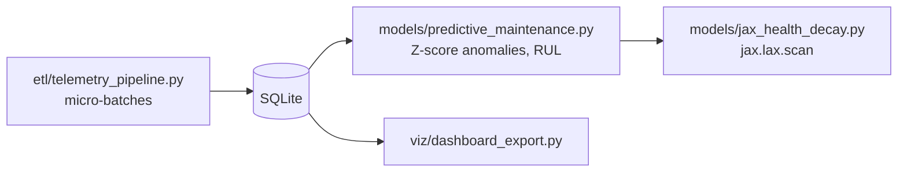
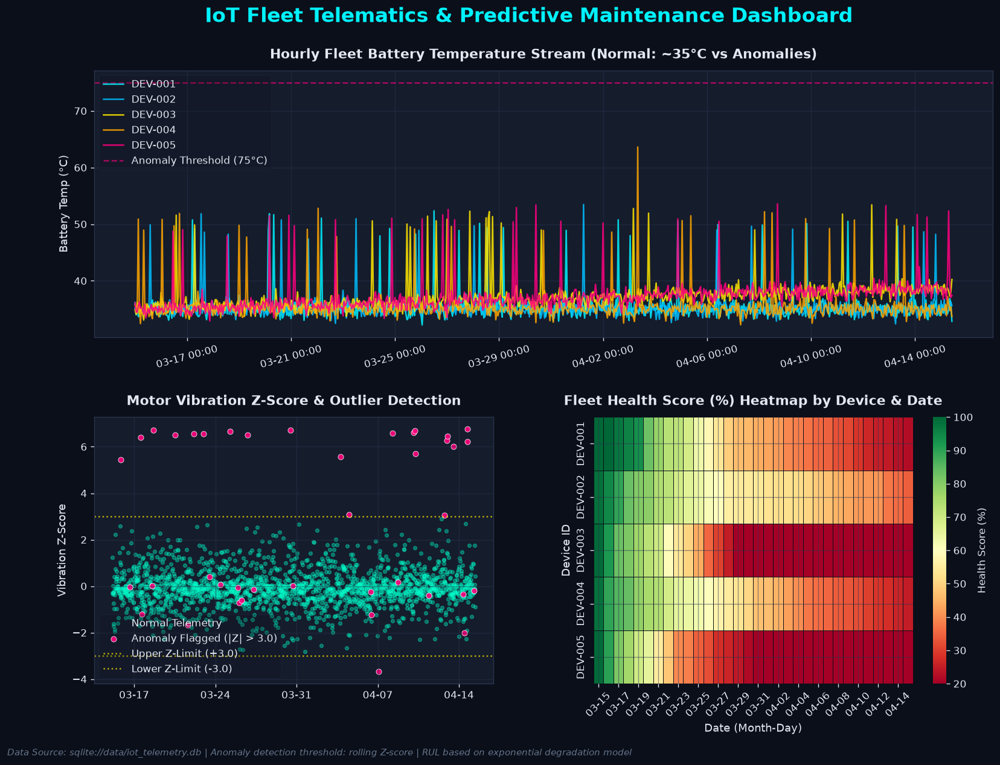

# Real-Time IoT Telematics & Predictive Maintenance

[](https://github.com/Deshraj-Jogiya/IoT-Telematics-Predictive-Maintenance/actions/workflows/ci.yml) 

Streams simulated EV fleet telemetry in micro-batches, flags sensor anomalies with rolling Z-scores, and estimates each battery's remaining
useful life (RUL) with an exponential degradation model, re-implemented as a JIT-compiled JAX scan.

## Highlights

- **Micro-batch ingestion** of battery and motor sensor logs into SQLite.
- **Anomaly detection:** rolling Z-scores on sensor metrics flag readings before they turn into failures, with threshold alerts.
- **RUL model:** exponential decay estimates remaining useful life per device.
- **JAX:** the sequential health-decay calculation runs as a single `jax.lax.scan`, tested to match the original per-row version exactly.

## Architecture





## Stack

Python, JAX, NumPy, pandas, SQLite, Matplotlib, pytest, GitHub Actions.

## Run it

```bash
pip install -r requirements.txt
python etl/telemetry_pipeline.py
python models/predictive_maintenance.py
python viz/dashboard_export.py
python -m pytest tests/test_jax_health_decay.py -v
```

## Data

The fleet telemetry is simulated.
