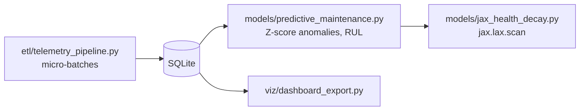

# Real-Time IoT Telematics & Predictive Maintenance

[](https://github.com/Deshraj-Jogiya/IoT-Telematics-Predictive-Maintenance/actions/workflows/ci.yml) 

Streams simulated EV fleet telemetry in micro-batches, flags sensor anomalies with rolling Z-scores, and estimates each battery's remaining
useful life (RUL) with an exponential degradation model, re-implemented as a JIT-compiled JAX scan.

## Highlights

- **Micro-batch ingestion** of battery and motor sensor logs into SQLite.
- **Anomaly detection:** rolling Z-scores (50-reading window, |z| > 3) on battery temperature and motor vibration. Measured against
  the simulator's 214 planted sensor spikes, which the detector never reads: 210 caught (98.1% recall) and 90.5% of flags are real
  spikes (`models/anomaly_detection_metrics.csv`, recomputed on every run).
- **RUL model:** exponential decay estimates remaining useful life per device; low-RUL and critical-health alerts repeat at most
  every 4 hours while a condition persists (404 alerts across the fleet instead of one per reading), covered by `tests/test_alerts.py`.
- **Fleet dashboard:** `viz/powerbi_export.py` writes daily device health, alerts and current device status to `exports/` for the
  Power BI report.
- **JAX:** the sequential health-decay calculation runs as a single `jax.lax.scan`, tested to match the original per-row version exactly.

## Architecture




## Stack

Python, JAX, NumPy, pandas, SQLite, Matplotlib, pytest, GitHub Actions.

## Run it

```bash
pip install -r requirements.txt
python etl/telemetry_pipeline.py
python models/predictive_maintenance.py
python viz/dashboard_export.py
python viz/powerbi_export.py      # CSVs for the Power BI report
python -m pytest tests/ -v
```

## Data

The fleet telemetry is simulated: 5 devices, one reading every 20 minutes from 2026-03-15 to 2026-04-15 (11,315 readings).
